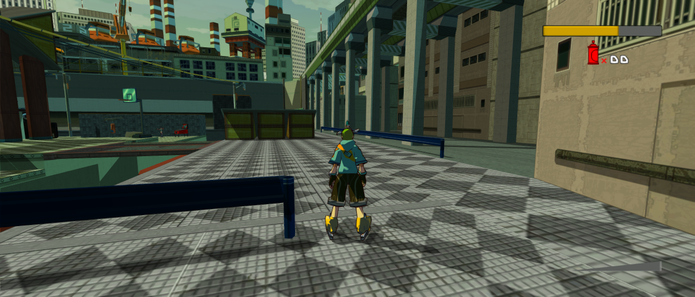
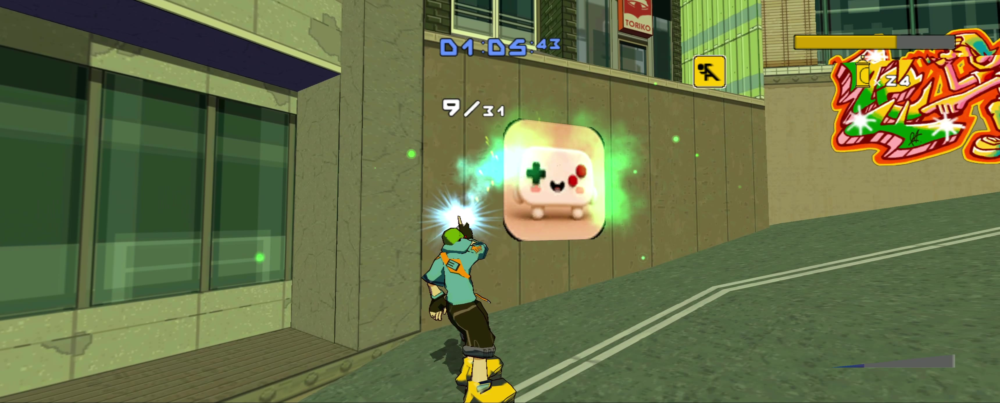
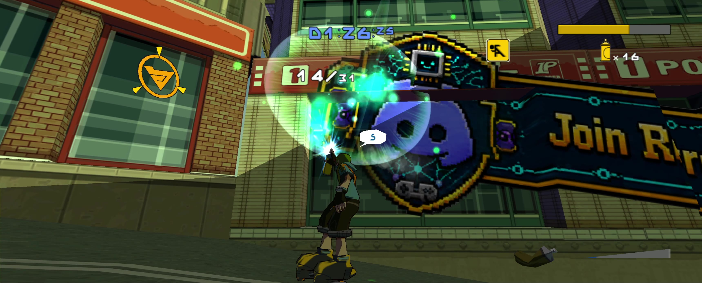

> **Early beta: not exhaustively playtested or tested end to end.** Expect bugs.
> [Report an issue](https://github.com/mstan/JSRFRecomp/issues/new) with your release version,
> reproduction steps and [diagnostic logs](docs/REPORTING-BUGS.md).

# Jet Set Radio Future Recompiled

Play JSRF on PC with widescreen, higher resolutions and your own graffiti.
Built on [XboxLLR](https://github.com/mstan/xboxllr), the same engine used by
[Blinx Recompiled](https://github.com/mstan/BlinxRecomp).

**[Download the Windows beta](https://github.com/mstan/JSRFRecomp/releases/tag/windows-preview-2026.11.02.1)**
· [Setup guide](docs/PLAYING.md) · [Report a bug](https://github.com/mstan/JSRFRecomp/issues/new)

You need your own supported **NTSC-U game files**. No compiler required.

*Actual gameplay in 21:9, with widescreen enabled.*

## Features

- **Widescreen on by default.** Fit to screen follows your window, including ultrawide displays.
- **Higher resolutions.** Internal resolution options, 1x–8x supersampling, FXAA and texture filtering.
- **Early Test Runs.** Collect an area's graffiti souls to unlock its challenges before finishing the story.
- **Your own graffiti.** Import PNG, JPEG or TGA artwork locally, with native, 2x or 4x detail.
- **Controller and keyboard support.** Select your device in Player 1; the launcher remembers it.
- **Native saves.** Save and load through the original game menus.
- **Optional presentation controls.** Startup and story-cutscene skipping, plus blended 60/120 Hz presentation.

Choose enhancements in **Mods**. Gameplay keeps its original timing; higher
graphics settings cost performance. [Options and setup](docs/PLAYING.md).

## Bring your own graffiti

Import artwork through **Mods → Manage Graffiti**, then select it through
**Roboy → Graffiti → Pick or Edit**. Your designs stay in your local save/profile.

*Two custom designs used in-game, from the owner's recording. [Image sources](docs/screenshots/NOTICE.md).*

## Start playing

1. Extract the Windows ZIP and open **Start Game.exe**.
2. Choose **Skip** in the optional console setup for a new local profile.
3. Select your supported `.iso`, `.xiso` or extracted `default.xbe` with its game assets.
4. Choose your controller and press **Play**.

The USA standalone release and NTSC-U certificate revision 4 are supported.
Keep the complete **`data` folder** when updating to preserve settings, console
identity and saves. [Save and Linux configuration guide](docs/PLAYING.md#saves-settings-and-updates).

A matching Linux AppImage is still being prepared for this release.

## Found a bug?

[Open an issue](https://github.com/mstan/JSRFRecomp/issues/new) with the release,
area, selected mods and steps to reproduce. Attach the crash dialog's
**diagnostic ZIP**, or follow the [log instructions](docs/REPORTING-BUGS.md).
Do not upload original game files or the `PRIVATE-DO-NOT-SHARE` folder.

## Credits and source

[Credits](CREDITS.md) · [Build instructions](docs/DEVELOPMENT.md) ·
[Component attribution](THIRD_PARTY_ATTRIBUTION.md) · [License](LICENSE-SCOPE.md)

Jet Set Radio Future and its original assets belong to their respective rights
holders. Original game data is not included. [Rights notice](RIGHTS-NOTICE.md).
