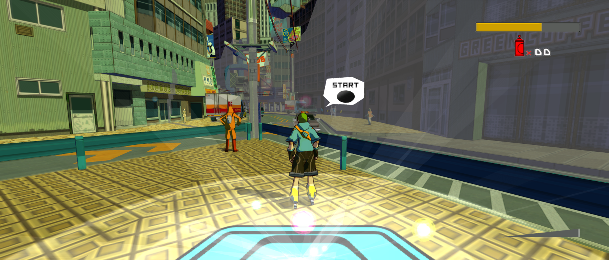

# Jet Set Radio Future Recompiled

Explore Tokyo-to on PC with adaptive widescreen, higher internal resolution
and controller support through an Xbox-themed launcher. JSRFRecomp uses
[xboxllr](https://github.com/mstan/xboxllr), the shared Xbox Low Level Recompiler.



*Chuo Street in the development preview, after loading an original in-game save.
[Image credits](docs/screenshots/NOTICE.md).*

[Features](#features) | [Getting started](#getting-started) |
[Controls and graphics](#controls-and-graphics) | [Credits](CREDITS.md)

## Features

| Feature | Available in the development preview |
| --- | --- |
| Adaptive widescreen | Fit gameplay to the window, or choose fixed aspects through 32:9, with expanded camera visibility and adjusted HUD anchors. |
| Higher resolution | Native internal heights of 1080p, 1440p, 1800p and 2160p. |
| Image quality | Optional FXAA, 2x2 or 3x3 supersampling, and anisotropic texture filtering. |
| Smoother presentation | Optional blended 60/120 Hz presentation while gameplay keeps its original timing. |
| Controller selection | The shared recomp-ui Player 1 card detects connected controllers and remembers the selected device. Keyboard input is also available. |
| Original saves | Real in-game saving and fresh-process Load Game, character selection and movement. |

Enhancements are optional mods. Original timing remains the default;
interpolation can show blended double edges and adds one source frame of
latency. Actual higher-rate gameplay is not available yet.

## Getting started

**Windows x64 development preview.** Self-contained downloads are being prepared;
native Linux builds are not available yet. Current setup still needs developer
tools and private preparation inputs. The release target is to require your own
matching game dump and generate the remaining supported setup locally.

You need your own **Jet Set Radio Future (NTSC-U)** game files. Other regions
and revisions have not been qualified. Original game files and generated game
code are not included in this repository.

The shared [setup and required-file guide](https://github.com/mstan/xboxllr/blob/master/docs/SETUP.md)
covers supported XBE hashes, private input preparation, optional original-console
imports and save preservation. ISO-only first-run setup remains a release task.
Native gameplay uses shared kernel services without booting a Microsoft kernel;
today's owned-kernel dependency is offline signing preparation. Optional-input
notices should explain only capabilities relevant to the selected title.

For an already prepared checkout, build and open the shared launcher:

```powershell
python tools/game.py build-launcher --paths local/paths.json
python tools/game.py run --paths local/paths.json --launcher
```

See [developer setup](docs/DEVELOPMENT.md), the
[title profile](native-title.toml) and the shared
[native-title driver guide](xboxllr/docs/NATIVE-TITLE-DRIVER.md) for prerequisites,
preparation and builds. The framework's
[release readiness plan](https://github.com/mstan/xboxllr/blob/master/docs/RELEASE-READINESS.md) tracks packaging,
platform support and distribution requirements.

## Controls and graphics

Choose the input device in **Player 1**, select enhancements in **Mods**, then
launch the game. Individual button remapping is not exposed in this preview.
Use `--launcher` to reopen settings if you previously selected Skip launcher.

Adaptive widescreen follows the window's aspect. Score text, dialogue portraits,
speech panels and inventory have title-specific placement fixes through 32:9.
Higher resolution and supersampling increase GPU cost; begin with original
presentation timing when comparing performance.

## Current playtest scope

The original title and attract demo run, and gameplay is available. A rapid
cheat-assisted sweep entered all 19 campaign/gameplay scene groups and nine
story-event groups, plus 13 additional encounter files. The final post-fight
sequence was reached with a forced defeat condition. These are coverage checks,
with explicit bypasses; they do not qualify every mission's natural mechanics.

Original save/load, sampled movement, grinding, graffiti and progression have
direct evidence. The owner briefly playtested the visual preview and reported
that it looked good. Extra-mode setup, deeper recovery checks and exhaustive
routes remain deferred. See the [gameplay burndown](docs/NATIVE-GAMEPLAY-BURNDOWN.md)
and [content ledger](docs/CONTENT-COVERAGE.md) for passed checks and limits.

The tested gameplay profile compiles original CPU code ahead of time and uses
shared native services. It has no guest x86 interpreter fallback. Unsupported
paths stop explicitly; scene-entry coverage is not proof that every function
or gameplay path has been exercised.

## Credits and distribution

Development and integration: **Matthew Stanley**. Special thanks to
**sp00nz / sp00nznet**, **Phobos**, **NoRain** and the **xemu contributors** for
the recompiler, renderer, audio and hardware work used or referenced by the
shared framework. [Credits](CREDITS.md) links their projects and the detailed
component inventory.

This repository does not grant rights to Sega's original game files. The
owner-original source uses [PolyForm Noncommercial 1.0.0](LICENSE), subject to
[license scope](LICENSE-SCOPE.md). Third-party work retains its own terms. The
current private reference executable is not cleared for distribution.
